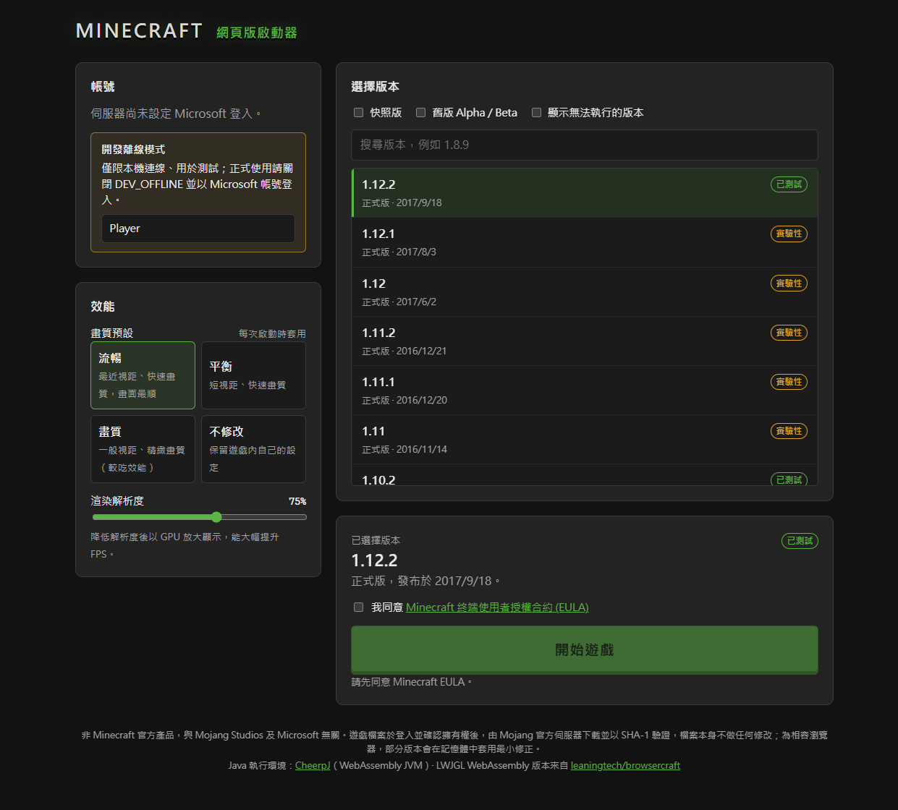

# Minecraft 網頁版啟動器

在瀏覽器裡遊玩**正版** Minecraft: Java 版：使用 Microsoft 帳號登入、確認擁有遊戲後，
從 Mojang 官方伺服器下載你選擇的版本，並在 [CheerpJ](https://cheerpj.com)（WebAssembly 版 JVM）中執行原版遊戲。
靈感與 LWJGL 2 的 WebAssembly 執行環境來自 [leaningtech/browsercraft](https://github.com/leaningtech/browsercraft)；
1.13 以後的版本則使用本專案以 JavaScript 實作的 LWJGL 3 原生層（GLFW → canvas、OpenGL → WebGL 2）。



> **[English README](README.md)**（含完整免責聲明、安全性說明、授權與引用資訊；以英文版為準）。
>
> 非 Minecraft 官方產品，與 Mojang Studios 及 Microsoft 無關。本專案不包含任何 Minecraft 檔案；使用前請閱讀英文版的 Legal notice。

## 功能

- **Microsoft 正版登入**：OAuth 2.0（PKCE）→ Xbox Live → XSTS → Minecraft 服務，並檢查遊戲授權（含 Game Pass）。
  Refresh token 只存在伺服器端（AES-256-GCM 加密），瀏覽器只拿到 HttpOnly 的工作階段 Cookie。
- **選擇版本、官方管道下載**：版本清單直接取自 Mojang 的 `version_manifest_v2.json`；
  用戶端 jar、函式庫、資源檔都從 Mojang 官方網域下載並驗證 SHA-1（伺服器僅允許 Mojang 官方主機，檔案只提供給已驗證擁有遊戲的帳號）。
- **流暢度**：降低渲染解析度再以 GPU 放大、畫質預設（流暢／平衡／畫質）、自動關閉瀏覽器中無效的功能（音效、網路、FBO），
  1.12.2 以前的主要版本實測 45–60 FPS。1.13 以後另以時間切片讓渲染執行緒優先，並依畫質預設減少環境粒子與生物數量；
  載入時把 CheerpJ 執行很慢的 VarHandle、lambda、字串串接改成一般位元組碼，1.16.5～26.3 在世界中約 30–45 FPS。
- **存檔保存在瀏覽器**（IndexedDB），關掉分頁後下次可繼續遊玩。

## 支援的版本

可執行範圍：**Alpha 1.0 ～ 26.3**（目前最新的正式版）。

| 版本 | 執行方式 |
| --- | --- |
| Alpha 1.0 ～ 1.12.2 | LWJGL 2：browsercraft 的 WebAssembly LWJGL 2 + gl4es |
| 1.13 ～ 1.16.5 | LWJGL 3（Mojang 原版 jar）＋ 本專案的 JavaScript LWJGL 3 後端；OpenGL 固定管線以 WebGL 2 模擬 |
| 1.17 ～ 1.20.4 | 同上（OpenGL 3.2 core → WebGL 2，GLSL 自動轉為 GLSL ES 3.00），Java 17 執行 |
| 1.20.5 ～ 1.21.11 | 同上；遊戲為 Java 21 編譯，載入時在記憶體中轉換為 Java 17 位元組碼 |
| 26.1 ～ 26.3 | 同上；遊戲為 Java 25 編譯（同樣在記憶體中轉為 Java 17）。26.3 改用 SDL3 視窗與新的 renderpearl 繪圖層，著色器經 shaderc／SPIRV-Cross 處理，皆以 JavaScript 模擬（`sdl.js`、`spirv.js`），使用 OpenGL 後端 |

下列版本已實際進入世界測試（Edge，渲染解析度 75%、「流暢」預設，FPS 上限 60；1.12.2 以前在 RTX 5060 Ti 上量測，1.16.5 以後是 2026-10 在 headless Edge 的軟體 WebGL 上重新量測，時間由開啟頁面起算）：

| 版本 | 結果 | FPS |
| --- | --- | --- |
| Beta 1.7.3 | ✅ 可遊玩 | 45 |
| 1.2.5 | ✅ 可遊玩 | 56 |
| 1.5.2 | ✅ 可遊玩 | 54 |
| 1.6.4 | ✅ 可遊玩 | — |
| 1.7.10 | ✅ 可遊玩 | 60 |
| 1.8.9 | ✅ 可遊玩 | 60 |
| 1.10.2 | ✅ 可遊玩（建立世界較慢） | — |
| 1.12.2 | ✅ 可遊玩 | 55 |
| 1.16.5 | ✅ 可遊玩（主選單約 1.5 分鐘；新世界約 3.5 分鐘） | 40–55（主選單 55） |
| 1.20.1 | ✅ 可遊玩（主選單約 1.2 分鐘；新世界約 5 分鐘） | 32–46（主選單 55） |
| 1.21.10 | ✅ 可遊玩（主選單約 1.2 分鐘；新世界約 3.7 分鐘） | 22–40（主選單 55） |
| 26.3 | ✅ 可遊玩（主選單約 1.5 分鐘；新世界約 3.5 分鐘，既有世界約 2.5 分鐘；1.16.5、1.20.1、1.21.10 的世界可直接升級，升級本身約 10 秒） | 45–55（主選單 55） |

其他版本標示為「實驗性」：使用與同一時期已測試版本相同的執行方式，應可執行但未逐一測試。
1.13 以後的版本瓶頸在 CheerpJ 執行遊戲邏輯（周圍生物的 AI 與碰撞、內建伺服器），畫面繪製本身只佔一小部分。

## 快速開始

需求：Node.js 20.12 以上、可連網（下載 CheerpJ 執行環境與 Mojang 檔案）。

```powershell
npm install
Copy-Item .env.example .env   # 然後編輯 .env，填入 AZURE_CLIENT_ID
npm start
```

Linux／macOS：

```bash
npm install
cp .env.example .env   # 然後編輯 .env，填入 AZURE_CLIENT_ID
npm start
```

開啟 <http://localhost:3000>，登入 → 選版本 → 同意 EULA → 開始遊戲。
首次啟動某個版本時，伺服器會從 Mojang 下載遊戲檔案（例如 1.2.5 約 4 MB、1.8.9 約 20 MB、1.12.2 約 47 MB，之後使用快取），
瀏覽器再按需讀取；加上 CheerpJ 執行環境，第一次進入主選單約需 30–70 秒。

### 設定 Microsoft 登入（Azure 應用程式）

Minecraft 不提供公開的 OAuth 用戶端，必須自行註冊 Azure 應用程式：

1. 到 [Azure 入口網站 → 應用程式註冊](https://portal.azure.com/#view/Microsoft_AAD_RegisteredApps/ApplicationsListBlade) 建立新註冊。
   - 支援的帳戶類型：**僅限個人 Microsoft 帳戶**（或「任何組織目錄及個人 Microsoft 帳戶」）。
   - 重新導向 URI：平台選 **Web**，填入 `http://localhost:3000/auth/callback`（正式部署時改成 `https://你的網域/auth/callback`，並設定 `.env` 的 `PUBLIC_URL`）。
2. 「憑證及祕密」→ 建立用戶端密碼，填入 `.env` 的 `AZURE_CLIENT_SECRET`；「概觀」中的「應用程式（用戶端）識別碼」填入 `AZURE_CLIENT_ID`。
   （若改用「行動和桌面應用程式」平台，可不設定密碼，僅使用 PKCE。）
3. **申請 Minecraft API 權限**：新的 Azure 應用程式必須先經 Mojang 審核才能呼叫 Minecraft 服務，
   請填寫 <https://aka.ms/mce-reviewappid>。審核通過前，登入會顯示「Minecraft 服務拒絕了這個 Azure 應用程式」。

### 開發離線模式

在 `.env` 設定 `DEV_OFFLINE=1`，**僅限本機（localhost）連線**可不登入直接以離線玩家啟動，方便在 Azure 審核通過前測試。
正式使用請保持 `DEV_OFFLINE=0`。

## 遊玩說明

- 點一下畫面鎖定滑鼠；`Esc` 解除並開啟遊戲選單。
- `F11` 或右上角「全螢幕」切換瀏覽器全螢幕。右上角的「主控台」可查看 Java 輸出。
- 中文輸入法（IME）可用於聊天與告示牌。
- 啟動器的「渲染解析度」越低越流暢；「畫質預設」會在每次啟動時寫入 `options.txt`（選「不修改」則保留遊戲內設定）。
- 疑難排解：在遊戲網址加上 `&debug=1` 可開啟 CheerpJ 詳細記錄。

## 運作方式

```
瀏覽器                                          Node.js 伺服器 (server/)                 官方服務
┌────────────────────────────┐   /auth/*      ┌──────────────────────────┐   OAuth     login.microsoftonline.com
│ 啟動器 index.html           │──────────────▶│ auth.js（PKCE、XBL、XSTS）│────────────▶ user/xsts.auth.xboxlive.com
│ 遊戲頁 play.html            │   /api/*       │ sessions.js（加密存放）    │             api.minecraftservices.com
│  ├ CheerpJ 4.3 (JVM/Wasm)   │──────────────▶│ mojang.js（版本、啟動計畫）│────────────▶ piston-meta / piston-data
│  ├ LWJGL 2.9.3 + gl4es Wasm │   /mc/*（Range）│ cache.js（SHA-1 驗證快取） │             libraries.minecraft.net
│  ├ lwjgl3/（JS 原生層）      │◀──────────────│ 僅提供給擁有遊戲的帳號      │             resources.download.minecraft.net
│  │  GLFW→canvas、GL→WebGL 2 │                └──────────────────────────┘
│  └ webmc-launcher.jar       │
└────────────────────────────┘
```

| 版本 | Java 執行環境 | LWJGL | 繪圖 |
| --- | --- | --- | --- |
| ～1.12.2 | CheerpJ Java 8 | 2.9.3（browsercraft 的 WebAssembly 版） | gl4es → WebGL |
| 1.13～1.16.5 | CheerpJ Java 17（遊戲為 Java 8 編譯） | Mojang 提供的 LWJGL 3 jar + `public/lwjgl3/` | 固定管線模擬（`ffp.js`）→ WebGL 2 |
| 1.17～1.21.11 | CheerpJ Java 17（Java 21 版本先在記憶體中降級） | 同上 | OpenGL 3.2 core → WebGL 2，GLSL 轉譯（`glsl.js`） |
| 26.x | CheerpJ Java 17（Java 25 位元組碼先在記憶體中降級） | 同上（LWJGL 3.4：SDL3、shaderc、SPIRV-Cross） | renderpearl 的 OpenGL 後端 → WebGL 2；SPIR-V 流程以替身模組模擬（`spirv.js`） |

CheerpJ 以 HTTP Range 請求延遲讀取 jar，所以遊戲只會下載實際用到的部分。世界存檔與 `options.txt` 位於 CheerpJ 的 `/files/.minecraft`（IndexedDB）。

### 讓原版遊戲在瀏覽器中執行的處理

`java/src/webmc/`（編譯為 `public/webmc-launcher.jar`）與 `public/js/` 解決了 CheerpJ 與原版遊戲之間的相容性問題：

| 問題 | 處理方式 |
| --- | --- |
| CheerpJ 只顯示屬於 AWT 元件的 X11 視窗 | 1.6+ 將 LWJGL 顯示嵌入無邊框 AWT Frame（`Display.setParent`）；1.6 以前以 Applet 方式載入（同原始啟動器） |
| X11 鍵盤只支援可列印字元與 Esc | 所有按鍵由頁面直接送入 LWJGL 鍵盤佇列（`KeyBridge` + CheerpJ natives），支援 Shift/Ctrl/F 鍵/方向鍵/IME |
| 以 CSS 放大畫面時滑鼠座標錯位 | 包裝 CheerpJ 的指標事件並換算座標（`input-scale.js`） |
| 沒有 NIO selector，內建伺服器無法啟動 | 提供不使用 socket 的 `NullSelectorProvider` |
| `getfield` 造成的 NullPointerException 不會進入 catch（1.8–1.12 模型載入當機） | 伺服器掃描用戶端 jar，`NpePatcher` 在記憶體中把這些方法的欄位讀取改為靜態存取器（不修改檔案，保留簽章） |
| gl4es 無 FBO、無 `glReadPixels` | 關閉 `fboEnable`；1.9+ 預先放置世界圖示；F2 截圖改為提示 |
| 遊戲執行中載入部分 JDK 影像類別失敗 | 啟動時預先執行一次影像操作 |

#### 1.13 以後（LWJGL 3）

遊戲與 LWJGL 3 都是 Mojang 提供的原版 jar（不修改檔案）；LWJGL 3 的原生程式庫（C）改由 `public/lwjgl3/` 以 JavaScript 實作，
其餘差異在載入類別時於記憶體中處理（`webmc.GameClassLoader`）：

| 問題 | 處理方式 |
| --- | --- |
| LWJGL 3 的原生程式庫無法在瀏覽器執行 | 以 JavaScript 實作 core（記憶體、JNI 呼叫、回呼）、GLFW（canvas、鍵盤滑鼠、IME、全螢幕）、OpenGL（WebGL 2）、stb_image，註冊為 CheerpJ natives；原生記憶體由 Java 端配置的堆積提供（`webmc.lwjgl.HeapAllocator`） |
| OpenGL 3.2 core 與 GLSL 1.50 | `gl.js` 對應到 WebGL 2（含虛擬預設 framebuffer、buffer texture 以 2D 貼圖模擬）；`glsl.js` 解析並檢查著色器型別，補上 GLSL ES 不允許省略的型別轉換、移除不支援的限定詞、改名保留字 |
| 1.13～1.16 使用 OpenGL 固定管線 | `ffp.js` 模擬矩陣堆疊、client arrays、`GL_QUADS`、霧、alpha test、光照、texenv、display list，以自動產生的著色器繪製 |
| LWJGL 3.1～3.2（1.13～1.16）以逐 8 位元組掃描的方式尋找 `java.nio.Buffer` 欄位位移，CheerpJ 的位移是欄位編號，掃描永不結束 | 啟動 JVM 前由頁面讀出這些 LWJGL 類別，把掃描方法改為依欄位名稱查詢，打包成 CheerpJ 記憶體檔案系統中的小 jar 並排在 LWJGL 之前（`lwjgl3/legacy.js`，原 jar 不變） |
| 1.13～1.16 以 `stbi_info_from_callbacks` 讀取材質尺寸（原生函式要回呼 Java 讀檔，CheerpJ 會遺失其結果） | 在記憶體中把呼叫改到 `webmc.lwjgl.Stb`，以 Java 讀出 PNG 標頭 |
| 1.16 以後生成第一個區塊前要先算出全部 128 座要塞的位置（每座都要搜尋周圍生態域），瀏覽器中需數十分鐘到近一小時 | 依要塞環的設定（原版第一圈距原點至少 88 個區塊），更靠近原點的區塊直接判定沒有要塞；更遠的區塊需要時才照原版方式精確計算 |
| 1.13～1.16 啟動時在背景預先最佳化所有 DataFixer 規則，在瀏覽器中會佔用數分鐘的執行時間 | 改為需要時才建立規則（與 LazyDFU 模組相同的做法） |
| 1.13～1.16 的載入畫面逐一繪製區塊進度方格（每格一次繪圖），渲染執行緒幾乎佔滿時間，內建伺服器無法產生世界 | 載入畫面迴圈的等待由 10～16 ms 改為 100 ms，讓伺服器取得大部分時間 |
| CheerpJ 的 Java 8 `Unsafe` 不支援 `getInt(null, 位址)` 這類絕對位址存取，LWJGL 3.1～3.2 全部依賴它 | 1.13～1.16.5 也以 CheerpJ 的 Java 17 執行（原版 1.16.5 可在 Java 17 執行） |
| 1.20.5 以後為 Java 21 位元組碼，CheerpJ 最高 Java 17 | `ClassDowngrader` 把類別降為 Java 17，Java 21 新增的 API 改呼叫 `webmc.jdk` 中的替代實作（包含其他類別只從 Java 21 繼承的方法，例如 Guava `ImmutableList.getFirst()`，依類別階層判斷）；`RecordMethods` 產生 record 的 `equals`/`hashCode`/`toString`（CheerpJ 的 record 引導方法無法處理陣列成員）；JFR 停用 |
| CheerpJ 的所有 Java 執行緒共用瀏覽器主執行緒，且不會被搶占 | `TimeSlices` 在遊戲中含迴圈的方法開頭插入讓步點；`webmc.jdk.Sched` 讓渲染執行緒優先，內建伺服器與區塊建構執行緒在渲染執行緒等待下一個畫面時執行，且每 16 ms 至少輪到一個時間片（畫面再慢，伺服器也保有約五分之一的時間） |
| CheerpJ 缺少 `Unsafe.compareAndExchangeReference`（1.21 的 `AtomicReference(Array).compareAndExchange` 會失敗） | 由下方的 `webmc.jdk.concurrent` 替代類別直接實作（關閉替代類別時改呼叫以 `compareAndSet` 實作的替代方法） |
| 1.17 以後的當機報告會執行 `lspci` 收集硬體資訊，CheerpJ 中第二次執行會永遠等待 | 以 SecurityManager 拒絕啟動外部程式（瀏覽器中本來就無法執行），遊戲與 oshi 會照常處理 |
| WebGL 2 沒有 `glDrawElementsBaseVertex`（1.21.6 以後的介面繪製使用）與部分 uniform block 查詢 | 繪製時暫時移動頂點屬性指標；以 WebGL 對應的查詢實作 |
| 新世界需先產生出生點周圍 21×21 區塊（1.14～1.20.4） | 改為 1.20.5 起原版的 5×5 |
| 每個 tick 抽樣 1334 個方塊播放環境粒子（火把、滴水） | 依畫質預設降為 25%／50%／100% |
| 模擬距離小時，原版生物上限讓所有怪物擠在玩家附近 | 依畫質預設把自然生成上限降為 40%／60%／100%（約等於原版在 17×17 區塊內的密度） |
| 畫面落後時原版每個畫面最多補跑 10 個 tick，使畫面越來越慢 | 每個畫面最多 1 個 tick：負載高時遊戲變慢，而不是變成幻燈片 |
| 26.3 以 SDL3 取代 GLFW | `sdl.js` 實作 SDL3 的視窗、GL context、事件（USB HID 掃描碼、IME 文字輸入、相對滑鼠＝pointer lock）、剪貼簿與畫面節奏 |
| 26.3 以 shaderc 把 GLSL 編成 SPIR-V，再以 SPIRV-Cross 轉回 GLSL | `spirv.js` 產生帶有反射資訊的替身 SPIR-V（含 Java 端會修改的 location／binding 欄位），最後直接輸出 WebGL 可用的 GLSL；`#include` 由 Java 端解析（`webmc.lwjgl.Shaders`，CheerpJ 會遺失回呼 Java 的原生函式的回傳值） |
| Java 22～25 新增的 API（`ScopedValue`、switch 模式比對的引導方法、`Reader.readAllAsString` 等） | 呼叫改到 `webmc.jdk` 中的替代實作 |
| CheerpJ 的 `ForkJoinPool` 竊取工作時會走到無法執行的 MethodHandle 路徑，26.x 準備新世界時 JVM 停止 | 26.x 的背景執行器改用一般佇列（`webmc.jdk.WorkerPool`）；只有所有工作者都在等待時才臨時增加工作者，避免互相等待卡住（產生區塊時工作者會等待排在自己後面的工作）。CheerpJ 的 `Thread.getState()` 一律回報 RUNNABLE，因此以 `LockSupport.getBlocker` 判斷是否在等待 |
| CheerpJ 的類別堆積（WebAssembly 記憶體）最多 256 MiB，26.x 未混淆且帶完整的區域變數表 | 載入時移除 LocalVariableTable／LineNumberTable 並清空只被它們使用的字串（`DebugInfo`；CheerpJ 的堆疊追蹤本來就不顯示行號），類別資料小約 21% |
| 26.x 每個讀取 NBT 的指令參數都重新建立整套 SNBT 文法；CheerpJ 即時編譯這段程式時耗用約 140 MiB 類別堆積並產生錯誤結果，建立世界失敗 | 同一個 `DynamicOps` 共用一份文法（`webmc.jdk.Grammars`，文法不可變） |
| CheerpJ 的 `Unsafe.putShort`／`putChar` 寫入 `byte[]` 時沒有作用，所以 JDK 的位元組陣列檢視（VarHandle、heap `ByteBuffer`）在位置除以 4 餘 2 時寫入的 int／long／double 變成 0。26.x 的 netty 4.2 以這種方式寫封包，實體的 UUID 與座標變成 0 或亂碼，玩家位置錯亂並被踢出（Invalid move player packet） | 設定 `io.netty.varHandle.enabled=false`，netty 改為逐位元組寫入（讀取不受影響） |
| CheerpJ 每次執行 VarHandle 存取都會重新綁定一個 MethodHandle（數十微秒）。Java 17 的 `AtomicReferenceArray` 等並行類別全靠 VarHandle，而用戶端每讀一個方塊都要從 `AtomicReferenceArray` 查區塊：26.3 世界中光這項就佔瀏覽器一成時間 | `StandIns` 把遊戲與函式庫中的 `AtomicReference(Array)`、`AtomicInteger/LongArray`、`AtomicBoolean`、`ConcurrentLinkedQueue` 換成 `webmc.jdk.concurrent` 的同名類別（一般陣列與欄位存取；CheerpJ 只在執行緒阻塞時切換，讀寫本身即不可分割，讀改寫操作另持有監視器）。26.3 世界中 FPS 約提高一倍 |
| CheerpJ 每次執行 invokedynamic 都會走一遍 call site 的 MethodHandle 鏈並依名稱解析目標方法：字串串接、switch 模式比對與 lambda 都很慢（遊戲在最熱的迴圈裡建立 lambda） | `Invokedynamics` 把字串串接改為 `StringBuilder`、switch 模式比對改為直接呼叫比對函式；`Lambdas` 在載入類別時為每個 lambda／方法參照產生一般類別（類似 retrolambda、D8），由 `GameClassLoader` 需要時才定義；可序列化的 lambda 維持原狀 |
| CheerpJ 編譯後的程式呼叫 `Math.log1p`、`sinh`、`cosh` 時找不到對應的 JavaScript 函式（console 出現 `Missing import: jlog1p`），結果為 0，之後的程式也可能出錯；`Math.floor`／`ceil` 則以 Java 逐位元計算，遊戲換算每個座標（`Mth.floor`）與產生地形時大量使用 | 呼叫改到 `webmc.jdk.MathStandIns`：前者依 fdlibm 的算法以 `exp`、`expm1`、`log` 計算（誤差 1 ulp 內），floor／ceil 在 int 範圍內經由 int 取整（與 JDK 逐位元相同） |
| 1.21.6 以後的世界載入畫面以方格畫出每個區塊的進度，新的 GUI 放置每個方格時都要和之前所有元素比對是否重疊：載入世界時超過一半的時間花在畫這張圖，伺服器只分到一小部分 | 載入畫面改呼叫 `webmc.jdk.LoadingScreens.noChunkMap`，不畫區塊方格（保留進度文字與進度條）；26.3 既有世界的出生區域從約 270 秒降到約 60 秒 |
| 用戶端 jar 有 Mojang 的簽章，JDK 從中讀取每個類別時都要計算 SHA-512 摘要（其實作又經過 VarHandle），佔到達主選單時間的四成 | `GameClassLoader` 以不驗證簽章的 `JarFile` 讀取類別（multi-release 項目的選擇與 JVM 相同）；26.3 主選單從約 117 秒降到約 84 秒 |
| Guava 的 future 與雜湊、netty 以名稱查找 `java.lang.invoke.VarHandle` 後改用 VarHandle | 對這些查找回報不存在，它們改用 Unsafe 或一般程式碼 |
| 26.x 的「World Options」畫面（難度、遊戲規則、區網）開啟時會開 socket 找可用的區網連接埠；瀏覽器沒有 socket，CheerpJ 丟出遊戲不會捕捉的 `NoClassDefFoundError`，畫面打不開 | `HttpUtil.getAvailablePort`／`isPortAvailable` 的呼叫改到 `webmc.jdk.Ports`（回傳 HttpUtil 自己在無法開 socket 時的 25564） |
| 26.x 每次讀寫 PalettedContainer 的方塊都經過 `ThreadingDetector`（一個鎖加一個 semaphore，只為了回報多執行緒誤用） | 呼叫改到空的 `webmc.jdk.Threads.unchecked` |
| 26.x 開啟舊版世界前要先升級檔案結構：要修改的檔案先複製到 `filefix` 資料夾再改（copy-on-write）。CheerpJ 的 `Files.copy` 在兩個檔案之間複製時失敗（`Invalid argument`，JDK 用的原生複製不存在），設定檔案時間也一樣失敗，所以舊版世界都無法開啟 | `Files.copy(Path, Path, …)` 的呼叫改到 `webmc.jdk.FileStandIns`，以串流複製（檔案時間能設定時才複製） |
| CheerpJ 的 `Files.createLink` 沒有建立硬連結卻回報成功（console 出現 `Missing import: path_symlink`）。26.x 測得「支援硬連結」後，把保留的檔案（區塊、實體…）以硬連結放進新的世界資料夾再刪除舊資料夾，升級後的世界會失去所有區塊 | `Files.createLink` 的呼叫也改到 `FileStandIns`，回報不支援；遊戲改為逐一搬移檔案（與不支援硬連結的檔案系統相同） |
| CheerpJ 重新命名資料夾時，IndexedDB 中的內容在同一個交易內搬完，但只清除兩個路徑本身的快取：舊路徑下 10 秒內開過的檔案仍以舊名稱快取（內容也是舊的），快取的資料夾紀錄仍列出改名前的內容，之後在其中建立檔案還會把舊的清單寫回。26.x 升級世界的最後以改名交換新舊世界資料夾，交換後讀不到新資料夾的 `level.dat`，升級失敗 | `public/js/fs-fixes.js` 包裝 CheerpJ 的 `cheerpOSRenameMain`：改名後一併清除兩個路徑以下的快取，仍開啟的檔案跟著改到新路徑 |
| CheerpJ 只在檔案的最後一個描述元關閉時才把內容寫入 IndexedDB，`fsync`／`fdatasync` 沒有作用（console 出現 `TODO: fsync`）。遊戲在世界載入期間一直開著區域檔（region），所以沒有「儲存並離開」就關閉分頁時，這次開啟世界後存下的區塊全部遺失（新的區域檔是空的） | `fs-fixes.js` 每 20 秒及頁面隱藏、關閉時，把內容有變更且仍開啟的檔案寫入 IndexedDB（等同遊戲在該時間點停止，區域檔的格式能承受這種情況） |
| LWJGL 3.3 以後 `STBImageWrite` 的靜態初始化會讀取 `stbi_zlib_compress` 等全域變數，模擬時回傳 NULL 使類別初始化失敗，世界縮圖變成空檔案；縮圖用的 stb_image_resize 也沒有實作 | `stb.js` 提供這些全域變數並實作 `stbir_resize_uint8(_linear/_srgb)` |
| 26.x 的世界載入進度每次記錄後只把下次記錄時間往後推 500 ms；瀏覽器中伺服器常數秒沒有更新進度，之後每次更新都會補記一行（每秒數十行相同的紀錄） | 改為從記錄當下起算 500 ms |

修改 Java 原始碼後以 `npm run build:java` 重新產生 jar（需要 JDK 9 以上，輸出為 Java 8 位元組碼）。

## 已知限制

- **沒有聲音**：瀏覽器中沒有 OpenAL，遊戲會以靜音模式執行。
- **無法連線多人伺服器**：瀏覽器無法建立 TCP 連線（單人與內建伺服器正常）。
- 結束遊戲請用「儲存並離開」：直接關閉分頁時遊戲來不及存檔，遊戲最近一次自動存檔（約每 5 分鐘）之後的變更會遺失
  （已存下的區塊每 20 秒寫入瀏覽器儲存空間）。
- 26.x 只支援 OpenGL 後端（遊戲選項中的 Vulkan 在瀏覽器中無法使用）。
- 1.13 以後的版本比 1.12.2 以前慢得多（CheerpJ 執行新版遊戲的 Java 程式碼約比桌面版慢 10–50 倍）：
  建立或載入世界需要一到數分鐘；周圍怪物多時內建伺服器跟不上即時（生物動作變慢），和平模式最流暢。
- 探索新地形時，地形產生速度（每秒約 1–2 個區塊）跟不上奔跑：跑太快時前方的區塊會稍後才出現，步行或停下等待即可。
  26.3 在和平模式下內建伺服器約 15 ms／tick，有敵對生物時約 40–70 ms／tick（遊戲時間變慢）。
- 1.13 以後的主選單會顯示「32-bit system detected」警告與「(Modded)」字樣：前者因 CheerpJ 是 32 位元 JVM，
  後者因遊戲類別在記憶體中轉換後不再帶有 Mojang 的 jar 簽章（jar 檔本身未修改）。
- 1.8+ 主選單全景背景為黑色、部分版本方塊接縫可見細線（關閉 FBO 與 gl4es 的限制）。
- 玩家造型（skin）無法從 Mojang 下載（瀏覽器 CORS 限制），顯示預設造型。
- CheerpJ 社群版僅供個人與非商業用途，商業用途需取得授權並設定 `CHEERPJ_LICENSE_KEY`。

## 開發

```powershell
npm run dev          # 伺服器檔案變更時自動重新啟動
npm test             # 單元測試（登入流程、啟動計畫、options.txt）
npm run build:java   # 重新編譯 public/webmc-launcher.jar
```

| 路徑 | 說明 |
| --- | --- |
| `server/` | Express 伺服器：登入、工作階段、Mojang 版本與檔案快取 |
| `public/index.html`、`js/launcher.js` | 啟動器介面 |
| `public/play.html`、`js/play.js` | 遊戲頁：下載進度、CheerpJ 初始化、顯示與輸入 |
| `public/lwjgl3/` | LWJGL 3 原生層的 JavaScript 實作（GLFW、OpenGL → WebGL 2、GLSL 轉譯、固定管線模擬） |
| `java/src/webmc/` | 在 JVM 內執行的啟動輔助程式與類別轉換 |
| `data/`（不納入版本控制） | 下載快取、加密工作階段 |

## 第三方元件

- [CheerpJ](https://cheerpj.com) 4.3 — Leaning Technologies，執行時由其 CDN 載入（社群版授權）。
- `public/lwjgl/`：LWJGL 2.9.3（BSD-3-Clause）官方 jar；`liblwjgl.so`、`gl4es.wasm`、`lwjgl.js` 為 [leaningtech/browsercraft](https://github.com/leaningtech/browsercraft)（Apache-2.0）提供的 WebAssembly 版本（LWJGL：BSD-3-Clause、gl4es：MIT）。
- LWJGL 3 的 jar 由 Mojang 官方伺服器下載；`public/lwjgl3/generated/natives.js` 僅列出官方 LWJGL 3 jar 中原生方法的名稱（`scripts/gen-lwjgl-tables.mjs` 產生）。
- Minecraft 遊戲檔案不包含在本專案中，一律於執行時由 Mojang 官方伺服器下載。
- 完整的授權文字見 [THIRD_PARTY_NOTICES.md](THIRD_PARTY_NOTICES.md)；本專案原創部分採 MIT 授權（[LICENSE](LICENSE)）。
